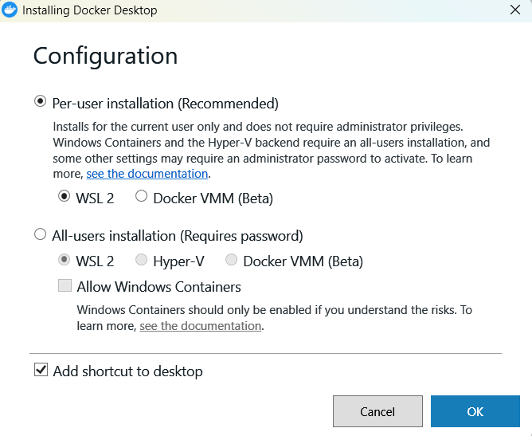
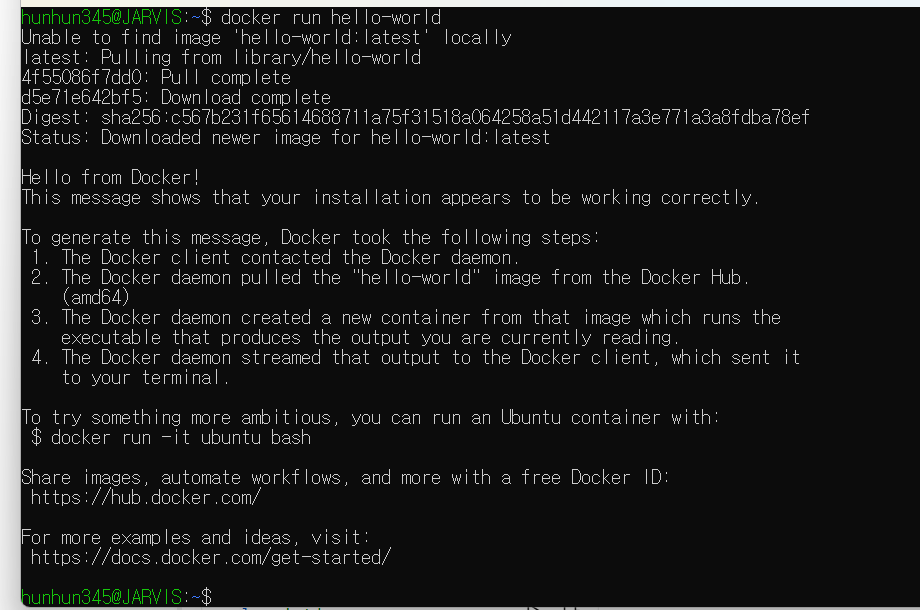
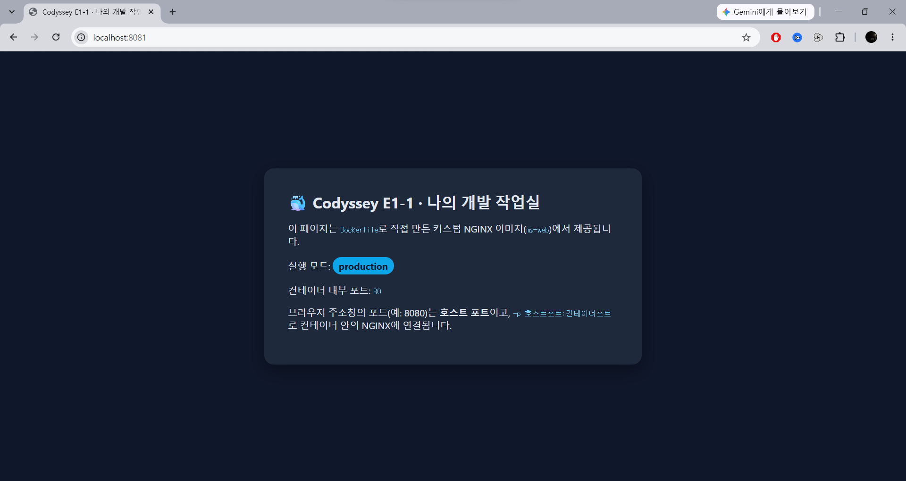
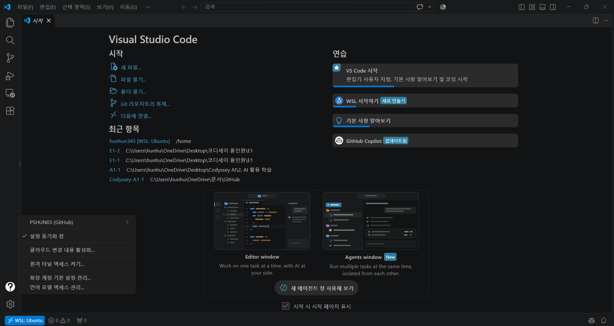
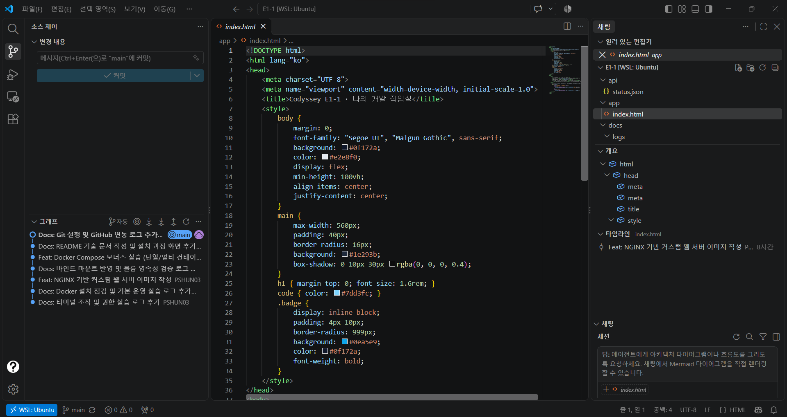
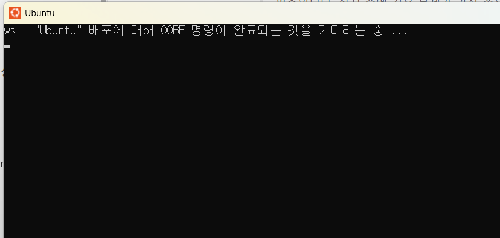
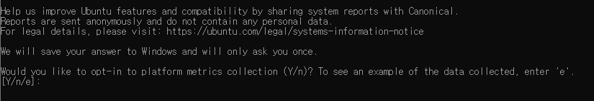
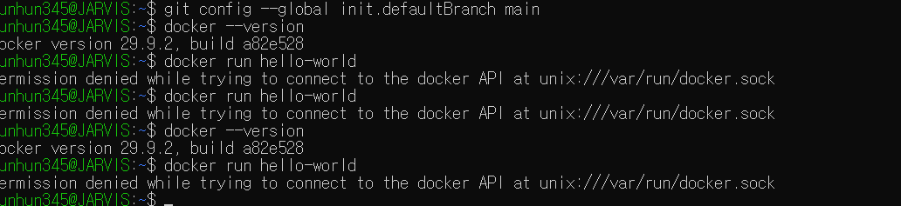

# 🐳 E1-1 · 내 컴퓨터에 개발용 '작업실' 꾸미기

터미널, Docker, Git을 직접 설치하고 실습하며 **"누가 어디서 실행해도 같은 결과가 나오는 개발 환경"** 을 만든 기록입니다.
모든 작업은 터미널(CLI)에서 수행했습니다. 실행한 명령과 출력 결과는 [`docs/logs/`](docs/logs)에, 화면 증거는 [`docs/screenshots/`](docs/screenshots)에 있습니다.

---

## 1. 프로젝트 개요

| 목표 | 수행 내용 |
|---|---|
| 터미널로 작업 환경 다루기 | 디렉터리 생성·이동·복사·이름 변경·삭제, 절대/상대 경로, 숨김 파일 확인 |
| 파일 권한 이해 | 파일·디렉터리 권한을 755/644/700으로 바꾸며 실행·진입 가능 여부 비교 |
| Docker 설치와 운영 | 설치 점검, 이미지/컨테이너 관리, 로그·리소스 확인, attach와 exec 차이 관찰 |
| 재현 가능한 실행 환경 | Dockerfile로 커스텀 웹 서버 이미지 제작, 포트 매핑으로 접속 |
| 데이터 다루기 | 바인드 마운트로 변경 즉시 반영, 볼륨으로 컨테이너 삭제 후에도 데이터 유지 |
| 버전 관리와 협업 준비 | Git 사용자 설정, VS Code와 GitHub 연동 |
| 보너스 | Docker Compose 단일/멀티 컨테이너, 운영 명령, 환경 변수로 설정 변경 |

---

## 2. 실행 환경

| 항목 | 내용 |
|---|---|
| OS | Windows 11 Pro + **WSL2** (`Ubuntu 26.04.1 LTS`, 커널 `6.18.54.1-microsoft-standard-WSL2`) |
| Shell | `GNU bash 5.3.9` |
| 터미널 | Ubuntu 앱 콘솔, VS Code 통합 터미널 (원격 연결: `WSL: Ubuntu`) |
| Docker | Docker Desktop (Engine `29.9.2`, WSL 2 백엔드), Docker Compose `v5.6.1` |
| Git | `2.53.0` (WSL Ubuntu), `2.55.0.windows.3` (Windows) |
| 에디터 | VS Code `1.144.0` + WSL 확장 |
| 작업 위치 | `~/codyssey/E1-1` (WSL Ubuntu 홈 디렉터리) |

> **참고:** 미션 문서의 OrbStack은 서울캠퍼스 macOS 환경용입니다. 이 실습은 Windows PC에서 진행했기 때문에 **Docker Desktop + WSL2**로 같은 `docker` 명령 환경을 구성했습니다.
>
> 작업 폴더를 Windows 쪽(OneDrive)이 아닌 WSL 홈 디렉터리에 둔 이유는 두 가지입니다. Windows 파일 시스템에서는 `chmod` 권한 변경이 제대로 반영되지 않고, Docker 바인드 마운트도 느려지기 때문입니다.



---

## 3. 수행 항목 체크리스트

- [x] 터미널 기본 조작 (현재 위치, 숨김 파일 포함 목록, 이동, 생성, 복사, 이동/이름 변경, 삭제, 내용 확인, 빈 파일 생성)
- [x] 권한 변경 실습 (파일 1개 + 디렉터리 1개, 변경 전/후 비교)
- [x] Docker 설치 및 점검 (`docker --version`, `docker info`)
- [x] Docker 기본 운영 명령 (`images`, `ps`, `ps -a`, `logs`, `stats`)
- [x] hello-world 실행
- [x] ubuntu 컨테이너 내부 진입 후 명령 실행, attach와 exec 차이 정리
- [x] Dockerfile로 커스텀 이미지 빌드 및 실행 (NGINX 베이스 + 정적 콘텐츠·설정)
- [x] 포트 매핑 접속 (8080, 8081 두 개 포트)
- [x] 바인드 마운트 변경 반영
- [x] 볼륨 영속성 (컨테이너 삭제 전/후 비교)
- [x] Git 설정 + VS Code GitHub 연동
- [x] 트러블슈팅 3건
- [x] 보너스: Docker Compose 기초 / 멀티 컨테이너 / 운영 명령 / 환경 변수

---

## 4. 저장소 구조

```text
Codyssey-E1-1/
├── README.md               # 기술 문서 (이 파일)
├── Dockerfile              # 커스텀 웹 서버 이미지 정의 (nginx:stable-alpine 기반)
├── app/
│   └── index.html          # 웹 서버 정적 콘텐츠 (/env를 호출해 실행 모드 표시)
├── nginx/
│   └── default.conf.template  # 환경 변수가 채워지는 NGINX 설정 (/health, /env)
├── docker-compose.yml      # 보너스: web + api 서비스 정의
├── api/
│   └── status.json         # 보너스: api 서비스가 제공하는 데이터
├── .env.example            # 보너스: Compose 환경 변수 예시 (.env는 저장소 제외)
├── .gitignore
└── docs/
    ├── logs/               # 단계별 명령 + 출력 로그 (01 ~ 09)
    └── screenshots/        # 브라우저, VS Code, 설치·오류 화면
```

---

## 5. 빠르게 재현하기

```bash
git clone https://github.com/PSHUN03/Codyssey-E1-1.git
cd Codyssey-E1-1

# 1) 커스텀 이미지 빌드
docker build -t my-web:1.0 .

# 2) 포트 매핑으로 실행 (호스트 8080 → 컨테이너 80)
docker run -d -p 8080:80 --name my-web-8080 my-web:1.0

# 3) 확인 (브라우저에서 http://localhost:8080 접속도 가능)
curl http://localhost:8080/health      # ok
curl http://localhost:8080/env         # {"app_mode": "production", "nginx_port": "80"}

# 4) 보너스: Compose로 web + api 실행 후 정리
docker compose up -d
docker compose exec web wget -qO- http://api:8000/status.json
docker compose down
```

---

## 6. 검증 방법과 결과 위치

| 항목 | 확인한 명령 | 확인 결과 | 로그 / 증거 |
|---|---|---|---|
| 터미널 조작 | `pwd`, `ls -la`, `mkdir`, `cd`, `cp`, `mv`, `rm`, `cat`, `touch` | 각 단계 뒤 `ls`로 결과 확인 | [01-terminal.md](docs/logs/01-terminal.md) |
| 권한 | `ls -l`, `stat -c "%A %a"`, `chmod 755/644/700`, `./hello.sh`, `cd secret_dir` | 644 → 실행 거부, 755 → 실행 성공 / 디렉터리 x 제거 → 진입 거부 | [02-permissions.md](docs/logs/02-permissions.md) |
| Docker 설치 | `docker --version`, `docker version`, `docker info` | Client/Server 모두 29.9.2, 데몬 정상 응답 | [03-docker-check.md](docs/logs/03-docker-check.md) |
| 기본 운영 | `docker images`, `ps`, `ps -a`, `logs`, `stats --no-stream` | 이미지 목록, 상태(Up/Exited), 로그, CPU·메모리 확인 | [04-docker-basics.md](docs/logs/04-docker-basics.md) |
| 컨테이너 실습 | `docker run hello-world`, `docker run -it ubuntu bash`, `exec`, `attach` | hello-world 성공, 내부 `ls`/`echo` 실행, exec는 유지·attach exit는 종료 | [04-docker-basics.md](docs/logs/04-docker-basics.md), [화면](docs/screenshots/hello-world.png) |
| 커스텀 이미지 | `docker build -t my-web:1.0 .`, `docker image inspect` | 빌드 성공, LABEL/ENV 적용, `(healthy)` | [05-custom-image.md](docs/logs/05-custom-image.md) |
| 포트 매핑 | `docker run -p 8080:80`, `-p 8081:80`, `curl`, 브라우저 | 두 포트 모두 200 응답, 매핑 없으면 접속 실패 | [05-custom-image.md](docs/logs/05-custom-image.md), [브라우저 화면](#8-6-포트-매핑-접속-증거-브라우저) |
| 바인드 마운트 | `docker run -v ~/codyssey/bind-demo:/usr/share/nginx/html`, 호스트 파일 수정 후 `curl` | 재시작 없이 응답이 "변경 전 → 변경 후"로 바뀜 | [06-bind-mount.md](docs/logs/06-bind-mount.md) |
| 볼륨 | `docker volume create`, `-v mydata:/data`, `docker rm -f`, 새 컨테이너에서 `cat` | 삭제 후 새 컨테이너에서 데이터 유지 (볼륨 없을 땐 소멸) | [07-volume.md](docs/logs/07-volume.md) |
| Git / GitHub | `git config --list`, `git remote -v`, `git push`, VS Code 계정·소스 제어 화면 | 사용자 정보·기본 브랜치 설정, 원격 연동·push 성공 | [09-git.md](docs/logs/09-git.md), [VS Code 화면](#8-9-git-설정과-github--vs-code-연동) |
| 보너스 Compose | `docker compose up/ps/logs/down`, `exec web wget http://api:8000` | 서비스 이름으로 통신, 환경 변수로 포트·모드 변경 | [08-compose-bonus.md](docs/logs/08-compose-bonus.md) |

---

## 7. 핵심 개념 정리

### 7-1. 절대 경로 vs 상대 경로

| 구분 | 기준 | 예시 (현재 위치: `~/codyssey/practice`) |
|---|---|---|
| 절대 경로 | 루트(`/`)부터 전체 주소 | `cd /home/hunhun345/codyssey/practice/docs` → 어디서 실행해도 같은 곳 |
| 상대 경로 | 현재 위치 기준 | `cd docs`(하위), `cd ..`(상위), `cd ../practice/backup` |

`~`는 홈 디렉터리(`/home/사용자`)의 줄임 표기이고, `.`은 현재 디렉터리, `..`은 상위 디렉터리입니다.

### 7-2. 파일 권한과 755 / 644 해석 규칙

`ls -l`의 `-rwxr-xr-x`는 맨 앞 1글자(파일 종류: `-` 파일, `d` 디렉터리) 뒤에 **소유자 / 그룹 / 그 외** 순서로 3글자씩 권한을 나타냅니다.

| 권한 | 숫자 | 파일에서 | 디렉터리에서 |
|---|---|---|---|
| r (read) | 4 | 내용 읽기 | 안의 목록 보기 |
| w (write) | 2 | 내용 수정 | 안에 파일 만들기·지우기 |
| x (execute) | 1 | 프로그램으로 실행 | 안으로 들어가기(경로 통과) |

각 자리의 숫자는 r, w, x 값을 더한 것입니다.

| 표기 | 소유자 | 그룹 | 그 외 | 기호 | 주로 쓰는 곳 |
|---|---|---|---|---|---|
| **755** | 7 = 4+2+1 (rwx) | 5 = 4+1 (r-x) | 5 (r-x) | `rwxr-xr-x` | 실행 파일, 디렉터리 |
| **644** | 6 = 4+2 (rw-) | 4 (r--) | 4 (r--) | `rw-r--r--` | 일반 파일 |
| **700** | 7 (rwx) | 0 (---) | 0 (---) | `rwx------` | 나만 쓰는 비공개 디렉터리 |

새 파일이 644, 새 디렉터리가 755로 만들어진 이유는 `umask 0022` 때문입니다. 기본값(파일 666, 디렉터리 777)에서 그룹·그 외의 쓰기(2) 권한을 빼기 때문입니다.

### 7-3. 이미지와 컨테이너, 그리고 격리

| 개념 | 비유 | 설명 |
|---|---|---|
| Dockerfile | 레시피 | 베이스 이미지와 추가할 파일·설정을 적은 설명서 |
| 이미지 | 붕어빵 틀 | Dockerfile로 빌드한 **읽기 전용** 실행 환경. 한 번 만들면 어디서나 같은 결과 |
| 컨테이너 | 붕어빵 | 이미지로 실행한 **격리된 프로세스**. 같은 이미지로 여러 개를 동시에 띄울 수 있음 (my-web-8080, my-web-8081) |

### 7-4. 포트 매핑이 필요한 이유

컨테이너는 호스트와 **분리된 네트워크**에서 실행됩니다. 그래서 컨테이너 안의 NGINX가 80번 포트를 열어도 호스트(내 PC)의 브라우저는 그 포트에 바로 닿을 수 없습니다. 실제로 매핑 없이 실행한 컨테이너는 **내부 접속은 성공했지만, 호스트에서는 접속에 실패**했습니다([5-4 비교](docs/logs/05-custom-image.md)).

`-p 8080:80`은 **"호스트의 8080번으로 들어온 요청을 컨테이너의 80번으로 전달하라"** 는 연결 규칙입니다. 호스트 포트만 다르게 주면 같은 이미지로 여러 컨테이너를 충돌 없이 동시에 띄울 수 있습니다(8080, 8081).

### 7-5. 바인드 마운트 vs 볼륨

| 구분 | 바인드 마운트 | 볼륨 |
|---|---|---|
| 지정 방법 | `-v /호스트/경로:/컨테이너/경로` | `-v 볼륨이름:/컨테이너/경로` |
| 저장 위치 | 내가 고른 호스트 폴더 | Docker가 관리하는 공간 (`/var/lib/docker/volumes/...`) |
| 주 용도 | 개발 중 소스 코드 수정을 **즉시 반영** | DB 데이터처럼 **컨테이너보다 오래 살아야 하는 데이터** 보존 |
| 이번 실습 결과 | 호스트 `index.html` 수정 → 재시작 없이 응답 변경 | 컨테이너 삭제 후 새 컨테이너에서 데이터 그대로 읽힘 |

컨테이너 내부(`/tmp` 등)에만 저장한 데이터는 컨테이너를 지우면 함께 사라집니다(7-3 비교).

### 7-6. Git vs GitHub

| 구분 | Git | GitHub |
|---|---|---|
| 정체 | 내 컴퓨터에 설치하는 **버전 관리 도구** | Git 저장소를 올려 두는 **원격 협업 플랫폼** |
| 하는 일 | 변경 이력 기록(`commit`), 브랜치, 되돌리기 | 저장소 공유, 백업, 코드 리뷰(PR), 이슈 관리 |
| 인터넷 | 없어도 동작 | 필요 |
| 연결 | `git remote add origin <URL>`로 GitHub 저장소를 원격으로 등록 → `git push`로 업로드 | |

---

## 8. 단계별 수행 요약

자세한 명령과 전체 출력은 각 로그 파일에 있습니다. 아래는 핵심 부분만 발췌했습니다.

### 8-1. 터미널 조작 → [전체 로그](docs/logs/01-terminal.md)

```bash
~/codyssey/practice$ touch empty.txt .hidden_config      # 빈 파일 생성 (하나는 숨김 파일)
~/codyssey/practice$ ls -la                               # 숨김 파일까지 보기
-rw-r--r-- 1 hunhun345 hunhun345    0 Nov  6 01:36 .hidden_config
...
~/codyssey/practice$ cp notes.txt backup/notes_copy.txt   # 복사
~/codyssey/practice$ mv notes.txt docs/                   # 이동
~/codyssey/practice$ mv docs/notes.txt docs/memo.txt      # 이름 변경
~/codyssey/practice$ rm -r docs                           # 삭제
```

### 8-2. 권한 실습 → [전체 로그](docs/logs/02-permissions.md)

```bash
~/codyssey/practice$ stat -c "%A  %a  %n" hello.sh
-rw-r--r--  644  hello.sh
~/codyssey/practice$ ./hello.sh
bash: ./hello.sh: Permission denied
~/codyssey/practice$ chmod 755 hello.sh
~/codyssey/practice$ ./hello.sh
스크립트 실행 성공! (실행 권한 확인)

~/codyssey/practice$ chmod 644 secret_dir     # 디렉터리에서 x 제거
~/codyssey/practice$ cd secret_dir
bash: cd: secret_dir: Permission denied
~/codyssey/practice$ chmod 700 secret_dir     # 소유자만 접근
~/codyssey/practice$ ls -ld secret_dir
drwx------ 2 hunhun345 hunhun345 4096 Nov  6 01:36 secret_dir
```

| 대상 | 변경 전 | 변경 후 | 결과 |
|---|---|---|---|
| 파일 `hello.sh` | 644 `-rw-r--r--` | 755 `-rwxr-xr-x` | 실행 거부 → 실행 성공 |
| 디렉터리 `secret_dir` | 755 `drwxr-xr-x` | 644 `drw-r--r--` → 700 `drwx------` | 진입 거부 → 소유자만 진입 |

### 8-3. Docker 설치 점검 → [전체 로그](docs/logs/03-docker-check.md)

```bash
~/codyssey$ docker --version
Docker version 29.9.2, build a82e528
~/codyssey$ docker info
...
 Server Version: 29.9.2
 Operating System: Docker Desktop
...
```

### 8-4. 컨테이너 실습: hello-world, ubuntu, attach vs exec → [전체 로그](docs/logs/04-docker-basics.md)

```bash
~/codyssey$ docker run -it --name ubuntu-it ubuntu bash
root@ba61aecab9a6:/# ls
bin   dev  home  lib64  mnt  proc  run   srv  tmp  var
boot  etc  lib   media  opt  root  sbin  sys  usr
root@ba61aecab9a6:/# echo "Hello from ubuntu container"
Hello from ubuntu container
root@ba61aecab9a6:/# exit
```

| 방식 | 연결 대상 | 빠져나올 때 | 컨테이너 상태 |
|---|---|---|---|
| `docker exec -it <이름> bash` | 새로 띄운 bash 프로세스 | `exit` | **유지 (Up)** |
| `docker attach <이름>` | 메인 프로세스(PID 1) | `exit` | **종료 (Exited)** |
| `docker attach <이름>` | 메인 프로세스(PID 1) | `Ctrl+P`, `Ctrl+Q` | 유지 (Up) |

→ 실행 중인 서비스에 들어가 점검할 때는 **exec**를 써야 서비스가 멈추지 않습니다.



### 8-5. Dockerfile 커스텀 이미지 → [전체 로그](docs/logs/05-custom-image.md)

**선택한 기존 베이스: (A) 웹 서버 베이스 이미지 `nginx:stable-alpine`** (공식 NGINX, Alpine 기반 경량 이미지)

| 커스텀 포인트 | 내용 | 목적 |
|---|---|---|
| `LABEL` | 이미지 이름·설명·작성자 | 이미지 출처와 용도를 `docker image inspect`로 확인 |
| `ENV APP_MODE, NGINX_PORT` | 실행 모드, 내부 포트 | 이미지를 다시 빌드하지 않고 `-e`로 설정 변경 (설정과 코드 분리) |
| `COPY nginx/default.conf.template` | 환경 변수가 채워지는 설정 | `/health`, `/env` 엔드포인트, `X-App-Mode` 응답 헤더 추가 |
| `COPY app/` | 기본 Welcome 페이지 교체 | 직접 만든 정적 페이지 제공 |
| `HEALTHCHECK` | 10초마다 `/health` 확인 | `docker ps`에 `(healthy)` 표시, 장애 감지 |

```bash
~/codyssey/E1-1$ docker build -t my-web:1.0 .
~/codyssey/E1-1$ docker run -d -p 8080:80 --name my-web-8080 my-web:1.0
~/codyssey/E1-1$ docker run -d -p 8081:80 --name my-web-8081 my-web:1.0
~/codyssey/E1-1$ docker ps --filter name=my-web
CONTAINER ID   IMAGE        COMMAND                  CREATED          STATUS                    PORTS                                     NAMES
3899e355dd14   my-web:1.0   "/docker-entrypoint.…"   16 seconds ago   Up 15 seconds (healthy)   0.0.0.0:8081->80/tcp, [::]:8081->80/tcp   my-web-8081
0457dc5516ad   my-web:1.0   "/docker-entrypoint.…"   17 seconds ago   Up 15 seconds (healthy)   0.0.0.0:8080->80/tcp, [::]:8080->80/tcp   my-web-8080
~/codyssey/E1-1$ curl -si http://localhost:8080/health
HTTP/1.1 200 OK
...
X-App-Mode: production

ok
~/codyssey/E1-1$ curl -s http://localhost:8081/env
{"app_mode": "production", "nginx_port": "80"}
```

### 8-6. 포트 매핑 접속 증거 (브라우저)

| 접속 주소 | 화면 |
|---|---|
| `http://localhost:8080` |  |
| `http://localhost:8081` |  |

### 8-7. 바인드 마운트 → [전체 로그](docs/logs/06-bind-mount.md)

```bash
~/codyssey$ docker run -d -p 8082:80 --name my-web-bind -v ~/codyssey/bind-demo:/usr/share/nginx/html my-web:1.0
~/codyssey$ curl -s http://localhost:8082
<meta charset=utf-8><h1>바인드 마운트 테스트: 변경 전</h1>

# 호스트에서 파일만 수정 (컨테이너 재시작·재빌드 없음)
~/codyssey$ echo "<meta charset=utf-8><h1>바인드 마운트 테스트: 변경 후 (호스트에서 수정)</h1>" > ~/codyssey/bind-demo/index.html
~/codyssey$ curl -s http://localhost:8082
<meta charset=utf-8><h1>바인드 마운트 테스트: 변경 후 (호스트에서 수정)</h1>
```

### 8-8. 볼륨 영속성 → [전체 로그](docs/logs/07-volume.md)

```bash
~/codyssey$ docker volume create mydata
~/codyssey$ docker run -d --name vol-test -v mydata:/data ubuntu sleep infinity
~/codyssey$ docker exec vol-test bash -c "echo \"hi from vol-test (볼륨에 저장한 데이터)\" > /data/hello.txt && cat /data/hello.txt"
hi from vol-test (볼륨에 저장한 데이터)
~/codyssey$ docker rm -f vol-test                       # 컨테이너 삭제

~/codyssey$ docker run -d --name vol-test2 -v mydata:/data ubuntu sleep infinity
~/codyssey$ docker exec vol-test2 cat /data/hello.txt   # 새 컨테이너에서 확인
hi from vol-test (볼륨에 저장한 데이터)
```

| 저장 위치 | 컨테이너 삭제 후 새 컨테이너에서 |
|---|---|
| 볼륨 `mydata:/data` | ✅ 데이터 유지 |
| 컨테이너 내부 `/tmp` | ❌ `No such file or directory` |

### 8-9. Git 설정과 GitHub / VS Code 연동 → [전체 로그](docs/logs/09-git.md)

```bash
~/codyssey/E1-1$ git config --list
user.name=PSHUN03
user.email=301172814+PSHUN03@users.noreply.github.com
init.defaultbranch=main
credential.helper=/mnt/c/Program\ Files/Git/mingw64/bin/git-credential-manager.exe
...
remote.origin.url=https://github.com/PSHUN03/Codyssey-E1-1.git
```

- `user.name`, `user.email`: 커밋 작성자 정보. 이메일은 개인 주소가 공개되지 않도록 GitHub의 **noreply 주소**를 사용했습니다.
- `init.defaultbranch=main`: 새 저장소의 기본 브랜치 이름을 `main`으로 지정합니다.
- `credential.helper`: WSL의 Git이 **Windows의 Git Credential Manager**에 로그인을 맡기도록 연결했습니다. 비밀번호나 토큰을 파일·터미널에 남기지 않고 push할 수 있습니다.

| VS Code GitHub 로그인 | VS Code 저장소 연동 (WSL: Ubuntu) |
|---|---|
|  |  |

---

## 9. 보너스: Docker Compose → [전체 로그](docs/logs/08-compose-bonus.md)

| 보너스 | 수행 내용 | 배움 포인트 |
|---|---|---|
| 1. Compose 기초 | `docker compose up -d web`으로 단일 서비스 실행 | 긴 `docker run` 옵션이 `docker-compose.yml`에 **문서화**되어 누구나 같은 환경을 재현 |
| 2. 멀티 컨테이너 | `web`(NGINX) + `api`(Python) 실행, `web`에서 `http://api:8000`으로 요청 | Compose 전용 네트워크의 내장 DNS가 **서비스 이름을 주소로** 바꿔 줌 (서비스 디스커버리) |
| 3. 운영 명령 | `up`, `ps`, `logs --tail`, `down` | 실행 → 상태 확인 → 로그 확인 → 정리의 **상태 확인 루틴** |
| 4. 환경 변수 | `WEB_PORT=8091 NGINX_PORT=8000 APP_MODE=staging docker compose up -d web` | 같은 이미지·같은 파일로 **설정만 바꿔** 포트와 모드 변경 (설정과 코드 분리) |

```bash
~/codyssey/E1-1$ docker compose exec web wget -qO- http://api:8000/status.json
{
  "service": "api",
  "message": "web 컨테이너가 서비스 이름(api)으로 찾아와 받은 응답입니다."
}
~/codyssey/E1-1$ WEB_PORT=8091 NGINX_PORT=8000 APP_MODE=staging docker compose up -d web
~/codyssey/E1-1$ curl -si http://localhost:8091/env
HTTP/1.1 200 OK
...
X-App-Mode: staging

{"app_mode": "staging", "nginx_port": "8000"}
```

> 보너스 5번(GitHub SSH 키)은 GitHub 계정 설정에 공개 키를 등록해야 하는 작업이라 이번 범위에서 제외했습니다. 대신 HTTPS + Git Credential Manager로 토큰을 파일에 남기지 않고 인증했습니다.

---

## 10. 트러블슈팅

### 트러블슈팅 1. Ubuntu 첫 실행이 "OOBE 명령이 완료되는 것을 기다리는 중"에서 멈춤

| 단계 | 내용 |
|---|---|
| **문제** | `wsl --install` 후 재부팅하고 Ubuntu를 실행하자 `wsl: "Ubuntu" 배포에 대해 OOBE 명령이 완료되는 것을 기다리는 중 ...`만 표시되고 진행되지 않음 |
| **원인 가설** | ① 설치가 실패했다 ② 설치는 됐지만 첫 실행 초기 설정(OOBE, Out-Of-Box Experience)이 다른 곳에서 진행 중이라 대기한다 |
| **확인** | PowerShell에서 `wsl -l -v` → `Ubuntu  Running  2`로 설치·실행 모두 정상 → 가설 ① 기각. 대기 중인 초기 설정 화면에 Canonical의 사용 통계 수집 동의 질문(`[Y/n/e]`)이 떠 있었음 |
| **해결** | 대기 중이던 초기 설정 화면에서 수집 동의 질문에 답하고, 사용자 계정(`hunhun345`)과 비밀번호 생성을 마치자 초기 설정이 끝나고 프롬프트(`hunhun345@JARVIS:~$`)가 나타남 |
| **배운 점** | "멈춘 것처럼 보이는" 상황은 먼저 상태 확인 명령(`wsl -l -v`)으로 설치 실패인지 대기 중인지를 구분해야 함 |

| 대기 화면 | 실제로 기다리던 초기 설정 질문 |
|---|---|
|  |  |

### 트러블슈팅 2. `docker run hello-world` 시 `permission denied ... docker.sock`

| 단계 | 내용 |
|---|---|
| **문제** | `docker --version`은 되는데 `docker run hello-world`에서 `permission denied while trying to connect to the docker API at unix:///var/run/docker.sock` |
| **원인 가설** | 현재 사용자가 Docker 데몬과 통신하는 소켓 파일에 접근할 권한이 없다 |
| **확인** | `ls -l /var/run/docker.sock` → `srw-rw---- root docker`: 소유자(root)와 **docker 그룹만** 읽기·쓰기 가능. `getent group docker` → `docker:x:1001:hunhun345`: 사용자는 이미 docker 그룹에 속해 있음. 그런데 오류가 난 기존 터미널은 Docker Desktop이 그룹을 추가하기 **전에** 열린 세션이었음. **새 세션**에서 `id -nG`를 보면 `docker`가 포함되고 `docker version`도 정상 응답 |
| **해결** | 리눅스의 그룹 변경은 **새로 로그인한 세션부터 적용**되므로, Ubuntu 터미널을 모두 닫고 다시 열자 `Hello from Docker!` 출력 |
| **대안** | 그래도 안 되면 PowerShell에서 `wsl --shutdown` 후 재실행. 그룹에 없다면 `sudo usermod -aG docker $USER` 후 재로그인 |



### 트러블슈팅 3. 컨테이너 대화형 셸에서 한글 입력이 `\355\225\234...`로 깨짐

| 단계 | 내용 |
|---|---|
| **문제** | `docker run -it ubuntu bash` 안에서 `echo "한글 테스트"`를 입력하자 명령줄이 `echo "\355\225\234\352\270\200 ..."`처럼 8진수 코드로 표시됨 (출력 결과는 정상) |
| **원인 가설** | 컨테이너에 문자 인코딩 설정(로케일, `LANG`)이 없어서, bash의 입력 편집기(readline)가 여러 바이트로 된 한글(UTF-8)을 글자로 인식하지 못한다 |
| **확인** | `docker run --rm ubuntu bash -c 'echo "LANG=[$LANG]"'` → `LANG=[]` (비어 있음). 같은 입력을 `-e LANG=C.UTF-8`을 준 컨테이너에서 하자 `echo "한글 테스트"`로 정상 표시 → 가설 확인 |
| **해결** | 한글을 입력해야 하는 대화형 컨테이너는 `docker run -it -e LANG=C.UTF-8 ubuntu bash`로 실행. 이미지에 고정하려면 Dockerfile에 `ENV LANG=C.UTF-8` 추가 |

```bash
~/codyssey/E1-1$ docker run --rm ubuntu bash -c 'echo "LANG=[$LANG]"; locale 2>/dev/null | head -2'
LANG=[]
LANG=
LANGUAGE=
~/codyssey/E1-1$ docker run -it --rm ubuntu bash
root@cc0e51e2a7a3:/# echo "\355\225\234\352\270\200 \355\205\214\354\212\244\355\\212\270"
한글 테스트
~/codyssey/E1-1$ docker run -it --rm -e LANG=C.UTF-8 ubuntu bash
root@41467267c018:/# echo "한글 테스트"
한글 테스트
```

---

## 11. 보안 및 개인정보 보호

| 항목 | 조치 |
|---|---|
| 이메일 | 커밋 작성자 이메일을 GitHub noreply 주소로 설정 (개인 이메일 비공개) |
| 인증 정보 | 토큰·비밀번호를 파일이나 명령에 쓰지 않고 OS 자격 증명 저장소(Git Credential Manager) 사용 |
| 키·환경 파일 | `.gitignore`로 `.env`, `*.pem`, `*.key`, `id_rsa*`, `id_ed25519*` 업로드 차단. 환경 변수는 예시 파일(`.env.example`)만 공개 |
| 로그 | 홈 디렉터리 전체 목록 대신 실습 폴더 목록만 기록. `docker info`, `git config --list`에 토큰·비밀번호가 없는 것을 확인 |
| 스크린샷 | 계정 비밀번호·토큰·인증 코드가 보이는 화면은 첨부하지 않음 |

---

## 12. 재현 시 주의사항 (PC에 종속된 부분)

| 항목 | 이 기록의 값 | 다른 환경에서는 |
|---|---|---|
| 홈 디렉터리 | `/home/hunhun345` | 본인 사용자 이름. 명령에서는 `~`를 쓰면 그대로 동작 |
| Docker 환경 | Windows: Docker Desktop + WSL2 | macOS: Docker Desktop 또는 OrbStack / Linux: Docker Engine (`sudo` 또는 docker 그룹 필요) |
| `credential.helper` 경로 | `/mnt/c/Program Files/Git/...` (WSL에서 Windows GCM 사용) | WSL이 아니면 설정 불필요 (각 OS의 Git 기본 인증 사용) |
| 포트 | 8080, 8081, 8082, 8090, 8091 | 이미 사용 중이면 `-p 9090:80`처럼 호스트 포트만 변경 |
| 베이스 이미지 | `nginx:stable-alpine`, `ubuntu`, `python:3.13-alpine` (태그 기준 최신) | 시점에 따라 세부 버전이 달라질 수 있음 |
